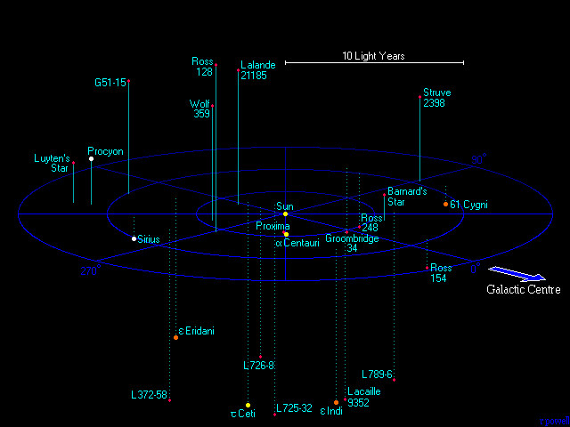

# REFERENCE



# StarsView — Interactive 3D Star Map Visualizer

An interactive 3D space visualization application built with **C++20** and **SFML**. It visualizes stars nearest to our Solar System in real three-dimensional space. All astronomical positions and distances are based on real-world scientific data measured in **light-years**.

The project features a custom-built 3D software projection engine implemented from scratch without relying on heavy graphical APIs like OpenGL or Vulkan.

## ✨ Key Features
* **Custom 3D Projection:** In-house implementation of transformation matrices, camera rotation around the origin (Yaw/Pitch), and linear zooming.
* **Painter's Algorithm (Z-Sorting):** Implemented correct depth-sorting using a custom projection depth (`depth`) comparator to handle object occlusion seamlessly.
* **Event-Driven Rendering Optimization:** The scene utilizes a `mustRender` flag state, redrawing only upon user input (mouse/keyboard events), dramatically reducing idle CPU overhead.
* **Data Serialization:** Built-in capabilities to save and load the stellar database to/from a structured **JSON** format using the advanced **Cereal** serialization library.
* **Astronomical Precision:** Star coordinates are accurately mapped in a 3D Cartesian system, with physical scales representing stellar sizes (giants vs. dwarfs) and colors matched to their real spectral classes.

## 🛠️ Software Architecture & Design Patters
The project is refactored according to SOLID principles, specifically focusing on the Single Responsibility Principle (SRP):
* `Engine` — Core mathematical library handling 3D point projections, camera matrices, and procedural geometry generation (e.g., coordinate rings).
* `SceneRenderer` — Isolated graphics rendering layer managing viewport clearing, primitive line strips, dashed projection indicators, and text positioning.
* `StarCatalog` — Data repository and abstraction layer managing life-cycle, file I/O operations, and JSON serialization states.
* `Camera` — Mathematical observer model enforcing strict runtime validation rules on FOV, clipping ranges, and orbital boundaries.

## 🚀 Installation & Build Guide
The project uses **CMake** (version 3.20+) along with **vcpkg** for modern C++ dependency management.

### Prerequisites:
* SFML 2.6+
* Cereal 1.3+

### Build Instructions:
```bash
# Clone the repository
git clone https://github.com
cd StarsView

# Configure the project with your local vcpkg toolchain
cmake -B build -DCMAKE_TOOLCHAIN_FILE=[path_to_vcpkg]/scripts/buildsystems/vcpkg.cmake

# Compile the executable
cmake --build build
```

## 🎮 Controls & Interface
* `W` / `S` — Pitch the camera view up and down.
* `A` / `D` — Orbit/Yaw the camera left and right around the central hub.
* `Mouse Wheel` — Dynamically scale camera radius (Zoom In / Out).
* `Ctrl + S` — Force serialize and save the current state of the catalog directly to `stars.json`.
 